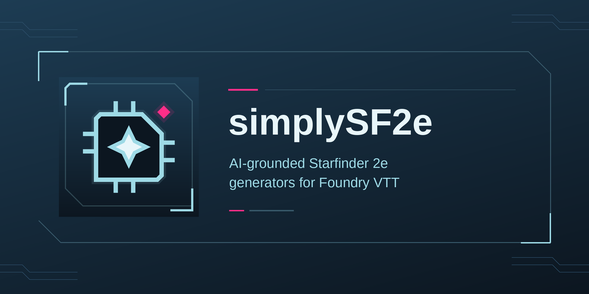

# SimplySF2e



AI generator for Starfinder 2e in Foundry VTT. Describe a creature, NPC, encounter, player character, magic item, shop or treasure hoard in plain words. SimplySF2e asks an AI model for a concept, then grounds named picks in real content from your installed Starfinder 2e compendiums. You can also give an existing NPC new fiction with Reskin. Ported from [SimplyPF2e](https://github.com/simplyjaytea/simplyPF2e).

> **Beta.** Automated tests and offline benches (every class at levels 1 to 20, creatures, the Item Forge, shops and treasure) run against the real Starfinder 2e data before each release. Live checks in Foundry are logged in [`docs/live-log.md`](docs/live-log.md); the last full live pass was on 2026-10-08, so most newer features are not yet checked live. Check every generated actor and item before you use it at the table.

## Requirements

- Foundry VTT v14 (minimum 14.361, verified 14.369).
- The **Starfinder Second Edition** game system (`sf2e`) 1.6.0 or later. Checked against 1.6.1.
- An AI provider that speaks the OpenAI-compatible Chat Completions API. This can be a hosted service (DeepSeek, OpenAI, OpenRouter, or another compatible gateway) or a model running on your own machine (Ollama, LM Studio).
- A GM account. Players cannot open the generator, the Item Forge or provider setup.

## Quick start

### 1. Install and enable

1. In Foundry, open **Add-on Modules → Install Module** and paste this manifest URL:

   ```
   https://github.com/simplyjaytea/simplySF2e/releases/latest/download/module.json
   ```

2. Launch a world that uses the Starfinder Second Edition system.
3. Open **Manage Modules**, tick **SimplySF2e**, and save.

That URL is the **stable** channel: it updates only when a release is promoted to stable. To try every change first, use the **beta** channel manifest instead. Beta builds are tested less.

```
https://github.com/simplyjaytea/simplySF2e/releases/download/beta/module.json
```

To roll back to an earlier version, see [Rolling back](#rolling-back).

When a GM logs in and no AI connection works yet, the **Welcome to SimplySF2e** window opens. Choose a provider, connect it and pick a model if asked, then generate a sample monster preview. System or compendium problems appear as one warning only when they need attention. Welcome stops opening by itself once the connection works, or when you tick **Don't show this again at login**. Reopen it any time with **Open Welcome** in the module settings or `/sf2e welcome` in chat.

After an update that changes something you can see, a **What's new in SimplySF2e** window opens once for the GM, listing only the new changes. **Got it** closes it; **Don't show for updates** stops it opening by itself. Opened by hand, it shows the newest notes and folds older ones under **Earlier changes**. A fresh install does not show it. Reopen it any time with `/sf2e whatsnew` or the **What's New** button in the module settings.

### 2. Connect an AI provider

Use the **Welcome** window for first-run setup:

1. Pick a provider:

   | Choice | API Base URL | Model |
   | --- | --- | --- |
   | **OpenRouter** (recommended) | `https://openrouter.ai/api/v1` | `deepseek/deepseek-v4.1-flash` |
   | **OpenAI** | `https://api.openai.com/v1` | `gpt-6-luna` |
   | **DeepSeek** | `https://api.deepseek.com/v1` | `deepseek-v4-flash` |
   | **Google** | `https://generativelanguage.googleapis.com/v1beta/openai` | Choose from the list; **Live check pending** |
   | **Ollama** | `http://localhost:11434/v1` | Choose an installed model |
   | **Anthropic via OpenRouter** (Advanced) | `https://openrouter.ai/api/v1` | Choose an `anthropic/*` model |
   | **LM Studio** (Advanced) | `http://localhost:1234/v1` | Choose from the list |

   **Advanced** mentions Jev and TypeSafe. Their setup is in the full **AI Provider Setup** window, opened with **Set up AI connection**.
2. Paste the provider's API key. Ollama and other local keyless servers show their **API Base URL** instead.
3. Click **Connect** (or press Enter in the key/URL field). Connect loads the provider's models through `/models`. It uses the preset's default only when that exact ID is listed. Otherwise, pick a returned model and click **Test & connect**. The chosen model gets a small connection test. If Connect fails, it restores your previous connection when possible.
4. Click **Generate a sample monster** to open a level-1 Monster preview with a fixed sample prompt. Nothing is created until you click **Create actor**.

The recommendations are **DeepSeek V4.1 Flash** (`deepseek/deepseek-v4.1-flash` on OpenRouter) and **GPT-6 Luna** (`gpt-6-luna` on OpenAI). An OpenRouter key reaches both and can report request costs. Local models work too, but small ones often fail the structured steps.

For named connections, custom endpoints, manual model IDs or saving without a test, open **Advanced → Set up AI connection**. The API Base URL can be the API root (normally ending in `/v1`) or a full `/chat/completions` address. The URL is shared with the whole world, so put secrets in the API key field: a URL with a user name, password or key-like query parameter (such as `api-key` or `token`) is refused.

**Keys are tied to one exact endpoint.** When you save, the key is authorized only for the API Base URL shown in the window. If you later change the URL without entering a new key, the old key is cleared, so it is never sent to a different service. If the generator ever says "Stored API key is not authorized for the current API Base URL and will not be sent", it shows the endpoint and an **Authorize for this endpoint** button. Click it only if that endpoint is the one you meant.

**Local and keyless providers.** Addresses on `localhost`, `*.local`, or private network ranges (for example `127.x`, `10.x`, `192.168.x`) are treated as local, and no key is required for them. The setup window reminds you of what the local server needs:

- **Ollama:** add your Foundry address to `OLLAMA_ORIGINS`.
- **LM Studio:** enable CORS (Developer → Server Settings, or `lms server start --cors`) and authentication.
- The local server must already be running before you test or generate.
- A Foundry page served over **HTTPS** cannot call a provider on plain **HTTP**. Browsers block that request. Serve the provider over HTTPS, or open Foundry over HTTP on the same trusted network.

**Saved connections (the connection bank).** You can keep several named connections, for example a hosted model and a local one, and switch between them.

- Use the **Saved connections** list at the top of AI Provider Setup to switch. Switching loads that connection's URL, model and key. Save first if you want to keep edits to the current connection.
- **New connection** (the + button) adds a connection and makes it active. A new connection never copies a key from another connection.
- **Delete connection** (the trash button) removes the active connection. You cannot delete the last one.
- When you have more than one saved connection, the generator and Item Forge headers show a drop-down so you can switch without opening setup. The headers also have **Test provider connection** and **Configure AI provider** buttons.

**Tokens and run cost.** After each run, a folded **Token usage** line under the preview shows the run total and cost; open it to list each step. Estimated token counts are marked with ≈. The report shows cost when the provider reports it (OpenRouter does). For other providers, enter optional **Input price** and **Output price** (USD per 1M tokens) under **Cost estimate** on the connection in AI Provider Setup (the section opens by itself if a price is invalid). Manual estimates are marked with ≈. If only some requests can be priced, the report says **at least** instead. Prices are saved with the connection and used only when the provider reports no cost. Leaving them empty shows no cost for an unpriced request. Your chat connection's manual prices never apply to Jev.

### Fast picks (Jev)

Jev is TypeSafe's fast decision model. It never writes text: it only picks from lists, which is the "choose the right compendium entry" part of a generation. SimplySF2e uses it for equipment and loot, creature feats and abilities, Player Character feats, class and ancestry choices, and Player Character spells. Concepts, descriptions and everything the AI writes still come from your chat model.

- **It is always on when it can run.** No toggle. The generator header has a **Fast picks: Jev** line that reads "on" or "off" and why.
- **What it needs.** Either your active connection is **OpenRouter** (its key is reused), or you save a separate Jev key in the **Fast picks** section of **AI Provider Setup** (it opens by itself when TypeSafe is the route). Pick its **Jev source** first: **OpenRouter** (an OpenRouter key) or **TypeSafe AI** (a key from TypeSafe). Any other connection works as before, without Jev.
- **TypeSafe AI from Foundry.** As of October 2026, TypeSafe's API refuses calls made from a browser (CORS), and Foundry modules run in your browser, so a TypeSafe key sent straight to api.typesafe.ai will not work yet. Use OpenRouter, or run your own CORS proxy that forwards to `https://api.typesafe.ai/v1/systemone` and enter its address as the **TypeSafe endpoint** (shown when TypeSafe AI is the source; blank means api.typesafe.ai). The endpoint must be https, or plain http only on your own computer (`localhost`). Switching the source or the TypeSafe endpoint clears the saved Jev key, because a key is only sent to the address it was saved for.
- **Test Jev.** The **Test Jev** button saves the Jev source and key, sends Jev one tiny question over the route generation would use, and tells you whether it answered (and how fast) or why not: Jev off, key rejected, TypeSafe blocking the browser, no network, or a timeout.
- **Fallback.** If a Jev request fails, times out (4 s per request), or Jev is unsure or finds no fitting entry, that step runs on your chat model instead. Nothing is guessed and the result looks the same either way. The token report marks such a step "chat model after Jev fell back"; a failed request also logs "using the chat model" in the browser console.
- **Cost.** Jev requests are billed on the account whose key is used: OpenRouter (see its pricing for `typesafe/jev-1.13`) or TypeSafe AI (`jev-1.13.0`). The token report after each run lists each step's tokens. Steps Jev can answer also show their seconds and which model answered, for example "Jev, 0.8 s" or "chat model after Jev fell back, 7.0 s".
- **Privacy.** Jev sees your concept summary and the names of candidate compendium entries, and nothing else. They go to openrouter.ai, which passes them to TypeSafe, or straight to TypeSafe (or your proxy, if you set a TypeSafe endpoint) when the Jev source is TypeSafe AI. Your Jev key is stored in your browser only and sent only to its chosen source.

### 3. Other settings

These appear directly in **Configure Settings → SimplySF2e**:

| Setting | Default | What it does |
| --- | --- | --- |
| **Creativity (temperature)** | 0.8 (range 0–2) | Higher gives more surprising concepts. Matching and selection steps always run at temperature 0. |
| **Max response tokens** | 8000 | Upper limit for one AI response. Each step uses its own smaller cap where it can. |
| **Request timeout (seconds)** | 90 | Abort a request if the provider sends **no data** for this long. Responses stream, so this setting does not cut off a slow model that keeps sending text. |
| **Run token budget** | 60,000 | Stop a run when its chat-model calls reach this total. Jev fast picks do not count. Set 0 to disable. |
| **Run deadline (minutes)** | 5 | Stop the whole run after this many minutes, even if data is still arriving. Set 0 to disable. |
| **Free Archetype variant rule** | Off | Gives generated player characters the variant's extra archetype feat slot at each even level. Picks that cannot be proven legal are left empty, not guessed. |

The **Compendium Sources** menu (button **Configure Sources**) chooses which compendium packs each category draws from: Bestiary Abilities, Spells, Feats, Equipment, Ancestries, Backgrounds, Classes, Class Features, Heritages and Bestiary Actors. Homebrew and module packs work too. A category left empty uses the SF2e system defaults (`sf2e.classes`, `class-features`, `feats`, `spells`, `equipment`, `ancestries`, `heritages`, `backgrounds`, `bestiary-ability-glossary-srd`). Bestiary Actors defaults to all seven creature packs: `alien-core-bestiary`, `guilt-of-the-grave-world-bestiary`, `secrets-of-the-swarm-bestiary`, `standalone-adventure-bestiary`, `starfinder-society-bestiary`, `rulebook-bestiaries`, `tales-from-the-vast-bestiary`. **Reset to defaults** restores them. Type in the filter box to find a pack by name or id, or tick **Selected only**; filtering only hides rows, so ticks you have not saved yet are kept.

### 4. Open the tools

All launchers are GM-only and only appear in an `sf2e` world.

| Where | What opens |
| --- | --- |
| **SimplySF2e** button in the **Actors** sidebar header | The generator (Monster, NPC, Encounter, Character, Reskin) |
| Right-click an NPC in the **Actors** sidebar, then **Reskin with SimplySF2e** | The generator's Reskin mode with that NPC loaded |
| **Item Forge** button on its own row just below the **Items** sidebar header | The Item Forge |
| **Shop** button in the **Actors** sidebar header | The shop generator |
| Chat: `/sf2e` or `/simplysf2e` | The generator |
| Chat: `/sf2e itemforge` | The Item Forge |
| Chat: `/sf2e shop` | The shop generator |
| **Treasure** button in the **Actors** sidebar header | The treasure hoard window |
| Chat: `/sf2e treasure` | The treasure hoard window |
| Chat: `/sf2e welcome` | The Welcome window: connect an AI provider and generate a sample monster |
| Chat: `/sf2e whatsnew` | The What's new window |
| Chat: `/sf2e [monster\|npc\|character\|encounter] [level] [description]` | The generator, pre-filled. Every part is optional, but they must come in that order, so a description that starts with a number is read as the level. Example: `/sf2e npc 4 street doc who patches up gang runners`. |
| Macro: `game.modules.get("simplysf2e").api.open()` / `.openItemForge()` / `.openShop()` / `.openTreasure()` / `.openWelcome()` / `.openWhatsNew()` | The generator / the Item Forge / the shop generator / the treasure window / the welcome window / the What's new window |

The chat command is not case-sensitive. A description starts a preview right away. Without a description, the command only pre-fills the form. Nothing is created until you press **Create actor** or **Create all actors**. A level outside the mode's range is clamped (−1 to 24 for Monster and NPC, 1 to 20 for Encounters and Player Character). Reskin has no chat shortcut.

## Using the generator

The window header shows the active connection and model, and one compact readiness row for **Compendium** and **Fast picks: Jev** (open it for details). When a compendium category is missing, the row opens by itself and says which categories. The Jev line says whether fast picks are on (see [Fast picks (Jev)](#fast-picks-jev)).

Choose a mode with the buttons at the top: **Monster**, **NPC**, **Encounter**, **Character**, **Reskin**.

Every mode except Reskin has three ways to start:

- **Generate monster / Generate NPC / Generate encounter / Generate character** generates **and creates** the result in one step, as long as every required compendium pick is matched.
- **Preview plan** generates the same thing but only shows a preview. Nothing is written to the world until you press **Create actor** (or **Create all actors** for an encounter). **Discard** throws the preview away.
- The **dice button** ignores your description and rolls a surprise concept at the chosen level. It always stops at the preview.

**Recent previews** keeps the last five previews you moved away from, so a paid AI run is not lost when you generate again. **Open** brings one back in its own mode so you can review or create it, and the **x** removes it. Creating an actor takes its preview off the list. The list lasts until Foundry reloads.

While a generation runs, a progress bar names each step and has a **Cancel generation** button. After each run the window shows a folded token usage line; open it for each step. Steps Jev can answer also show how long they took and which model answered.

AI-written prose is shown as text, not as Foundry commands. It cannot add links, inline rolls, checks or templates. Working links and rolls are supplied by the module or published content.

**Advanced options** (a fold-out under the description) holds:

- **Preset**: a flavor guide for the AI. It offers the eight Standard classes (Envoy, Mechanic, Mystic, Operative, Solarian, Soldier, Technomancer, Witchwarper), four Starfinder Archetypes (Corp Enforcer, Free Captain (Pirate), Street Cyberdoc, Bounty Hunter), and your own custom presets. **Manage presets** lets you create, edit, duplicate, delete, export and import custom presets as JSON. Custom presets are saved in the world.
- **Rarity**: the creature's rarity. In Character mode this becomes **Rarity cap**, which excludes ancestries, backgrounds and heritages rarer than the cap.
- **Monster Adjustment**: **Normal**, **Elite (+1 Level)** or **Weak (-1 Level)** (not shown in Character or Encounter mode). It applies to single Monster and NPC generation.
- **Treasure amount**: **Stingy**, **Standard** or **Generous**.
- **Allow spellcasting**: untick it to keep spells off the result.
- In Encounter mode: **Party size** (1–8) and **Threat** (**Trivial**, **Low**, **Moderate**, **Severe**, **Extreme**).

### Monster and NPC

Use **Monster** for a creature (a "xenobiology specimen") and **NPC** for a person (a "personnel file"). Describe it under **Describe the creature** or **Describe the NPC**, then set **Level** (−1 to 24).

The AI chooses only descriptive scales such as "high AC" or "low HP". SimplySF2e turns those into numbers using the *Starfinder GM Core* Building Creatures tables. Spells, feats, equipment and loot are each picked from a short list of real compendium entries. Abilities can come from the compendium, a module-built template or narrative text. The preview marks each pick:

- a check mark means it matched a real compendium item;
- **Module-built** marks a working Area Blast or Aura made by SimplySF2e;
- **Narrative only** marks an ability the AI made up on purpose. It is flavor text with no mechanics, and it is allowed.

A module-built **Area Blast** gives a bespoke breath or blast a cone or line, damage and a save DC. A limited blast includes a recharge roll. A module-built **Aura** calls for a save when a creature enters or starts its turn there, then describes a condition or damage. Its radius appears on the canvas, and you apply the result. The module supplies the numbers from *GM Core* tables and published creatures.

The glossary abilities **Constrict**, **Greater Constrict**, **Swallow Whole**, **Engulf**, **Trample**, **Frightful Presence** and **Stench** also get level-appropriate values. SimplySF2e fills their damage, DCs, sizes and aura radii. Trample uses the creature's own melee Strike. If a glossary ability cannot be filled safely, its working version is left out. Safe flavor text may remain as **Narrative only**. The browser console names the ability.

If the creature carries loot, **Reroll loot** generates different loot without changing anything else. The dice next to a spell, feat or published ability swaps just that pick for a different compendium entry of the same kind (a spell keeps its rank and tradition); it costs one small AI call and never repeats a pick the creature already has. A rerolled glossary ability such as Constrict is filled for this creature like any other; if the new pick cannot work for this creature (for example Swallow Whole on a Tiny creature), the reroll is refused, the old pick stays and a warning says why. The AI cannot give a creature the same glossary ability twice. **Create actor** makes the NPC actor, using art from the closest-matching creature in your Bestiary Actors packs. The finished panel reports how much came from the compendium. **Open sheet** jumps to the new actor.

After **Create actor** (and **Create all actors** for an encounter), a **Stat check** reads the new sheet and compares its AC, max HP, Perception, saves, strike attack bonuses and spell DC with the preview and with the *Starfinder GM Core* range for the creature's level. Each number shows its GM Core scale (for example "AC 21 (moderate)"). A number that differs from the preview, sits outside the GM Core range, or cannot be read is marked, and the GM also gets a chat whisper listing it so it is still there after the window closes. The check only reports; it never changes the actor. Player Characters are not checked, because the system computes their numbers.

### Encounter

Set **Party level**, **Party size** and **Threat**, and optionally fill **Describe the encounter theme (optional)**. The AI designs a theme and a set of roles, and SimplySF2e then builds each member through the full creature pipeline. That means one AI round per creature, so encounters cost more tokens than a single monster. Up to three creatures are built at the same time, which cuts the wait for bigger encounters. A local provider (Ollama, LM Studio, or another address on your home network) still builds them one at a time, because most local servers answer one request at a time. If one creature fails, the others stop and nothing is kept.

The preview shows each member's level, role (**Boss**, **Minion**) and key statistics in a small grid, with **Add one** / **Remove one (0 skips this creature)** counters. The header chips show **XP** and **Credits** spent against the encounter's budgets. **Create all actors** creates every member inside a new Actors folder named after the encounter. If any member fails, the whole batch and its folder are rolled back.

### Character

Fill **Describe the character** and set **Level** (1–20). Character generation is **complete-only**: it supports only the eight published Starfinder 2e classes (Envoy, Mechanic, Mystic, Operative, Solarian, Soldier, Technomancer, Witchwarper). If none of them is available in your enabled packs, the generator says so.

SimplySF2e picks a real ancestry, heritage, background and class, plus feats, skills, equipment, starting wealth and (for Mystic, Technomancer and Witchwarper) spells. It puts them on a character actor, and the sf2e system works out AC, HP, saves and proficiencies itself. The preview shows **Skill priorities** and the picks with their match marks.

- **Feats** are checked against what the character will have at each level: its attributes (for example "Charisma +2"), skill ranks, heritage and class path. General feat slots can also hold skill feats, as in the system. If no legal feat exists for a slot, the character is still created with that slot empty, and the GM gets a whisper naming the slots to fill by hand. An illegal feat is never placed.
- **Multiclass** (only with the **Free Archetype** setting on): pick a second class in **Multiclass**, choose **Let the AI decide** to let your description settle it (for example "a soldier who dabbles in mysticism"), or leave it at **None**. The dedication goes in the level 2 archetype slot, and later archetype slots favor that archetype's feats. A second dedication only appears after two feats of the first, as the rules require. Mystic, Witchwarper and Technomancer dedications get their own spell list: two cantrips, then the basic, expert and master spellcasting slots as you take those feats.
- **Technomancer** characters get a full spell database (10 cantrips, five 1st-rank spells, two more spells each level, and their programming language's cache spells) and prepare their slots from it. Their programming language's magic hack is added as a focus spell.
- **Living Hologram and SRO** characters get their size choice answered for you.
- **Mechanic** characters who pick the Drone exocortex get a whisper reminding you to set up the drone companion by hand; SimplySF2e does not create companion actors.

During creation, the system may open its own **choice dialogs** for options the module could not answer safely. Complete them to continue. Afterwards the generator shows **Character created: review**: the snapshot note once, then a **To review** list of short actions (open one for the full explanation). It covers:

- the resulting skill proficiencies;
- equipment readiness (for example, an untrained weapon left stowed, or a ranged weapon whose ammunition you still need to load);
- any features that still have no recorded choice.

This report is a snapshot taken at creation time. It does not refresh when you edit the character, and it is not a full rules check.

### Reskin

Reskin gives an existing NPC new fiction. Its numbers stay the same unless you choose a new level.

1. Choose **Reskin**, or right-click an NPC in the Actors sidebar and choose **Reskin**.
2. Drag an NPC from the Actors sidebar or from a bestiary compendium onto the drop zone. Drop another one to replace it. Only NPC actors are accepted.
3. Describe the new look under **Reskin theme**.
4. Press **Reskin creature**, or **Preview plan** to review first.

The AI writes a new name, a read-aloud description and Recall Knowledge text, and may rename strikes and abilities. **Create reskinned copy** creates a new actor. Without a level change, its statistics, rules, traits and items are copied unchanged. The original creature is not modified.

**New level** re-levels the copy. Set it with the − / + buttons (−1 to 24) and a table shows each changed number at the old and new level. Every number keeps its Starfinder GM Core scale: a creature with high AC at level 3 has high AC at level 7, and one point above "high" stays one point above. HP scales by the same proportion, and each strike's main damage moves to the matching damage scale. AC, HP, Perception, saves, attribute modifiers, skills, strikes, spell DC and spell attack, and resistance and weakness values all move.

Area Blasts, Auras and glossary abilities built or filled by the module are rebuilt for the new level. Their reskin names are kept. Published abilities that the module did not fill keep their text. If an ability cannot be rebuilt, it stays at the old level and the preview gives the reason.

Spells and their ranks, DCs or damage written into published ability text, the ritual DC, gear, and Elite/Weak stay as they are, so check those on the new sheet. An attribute or skill lower than every GM Core scale (such as a mindless creature's Int −5) also stays as it is. An Elite or Weak creature is re-leveled from its base level. An Extreme attribute modifier has no printed value at level 0 or below, so it becomes the High value there and stays High if you re-level back up.

## Using the Item Forge

Pick an **Item type** from the compact row of kinds (its description shows below), fill **Describe the item**, and set **Item level** (1–24) and **Rarity**. Press **Generate** (press it again for a new version). Then press **Create Item**. The item lands in the Items directory, and you drag it onto a character sheet from there. The gear in the Compendium Content row at the top opens Compendium Sources.

| Item type | What you get |
| --- | --- |
| **Wondrous Item** | Passive effects copied from real published equipment of a suitable level and rarity, plus an optional once-per-day activated power. |
| **Augmentation** | An implanted item (tech, biotech, magitech or necrograft), built the same way as a wondrous item. |
| **Solarian Crystal** | A crystal for a solarian, with general passive effects. It does not change solar weapon damage. |
| **Weapon (upgrades)** | A real weapon from your equipment pack at a level-appropriate equipment grade (commercial, tactical, advanced, superior, elite, ultimate, paragon), with real upgrades installed. |
| **Armor (upgrades)** | The same, for a real armor item. |

Notes:

- Passive effects come only from real published items. If none survive the checks, the preview says the item will be flavor-only and suggests regenerating. If some effect kinds have no published source at your chosen level and rarity, the Forge lists them as not offered.
- An activated power is a pre-written script macro named "Activate: *item name*", stored in a **SimplySF2e Item Forge** macro folder and linked from the item's description by an **Activate** link. The item is limited to once per day, and its uses refill when the owner uses the system's Rest for the Night. Deleting the last copy of a forged item also deletes its macro.
- Prices preview in credits. The system recalculates the final price and level of graded weapons and armor itself.
- Upgrades that install into any weapon or any armor are used, plus upgrades made for projectile weapons when the base weapon is in the projectile group. Upgrades restricted to other weapon or armor traits are skipped. The preview names any requested upgrade that did not fit, either because no slot was free or because it is not made for that weapon.
- A created item keeps one grade label, and a base item that already has a published grade keeps it.

## Using the shop generator

Fill **What does it sell, and who runs it?**, then set **Shop level** (0–20), **Stock size** (Small 8, Standard 16 or Large 24 items) and **Rarest stock** (Common, Uncommon or Rare). Press **Generate shop**.

The AI writes the shop's name, keeper and description, and picks the stock from a list of real items in your equipment compendium: items of the shop's level or lower, of the kinds it sells, no rarer than your setting. It never names an item or a price itself. Each row shows the item's published level and price in credits. Consumables and ammunition are stocked 3 at a time, everything else singly. Remove any row with its **×** button.

**Create merchant** makes a loot actor in Merchant mode, holding exact compendium copies of the stock. Drag it onto a scene; players buy from its sheet. Change quantities or prices there.

## Using the treasure window

Set **Party level** (1–20) and **Party size**, or press **Use my party** to fill both from your world's Party actor. Pick **How much**: **One encounter** (the per-encounter share of the level's treasure) or **Whole level** (the whole level's treasure). Pick the **Rarest item** (Common, Uncommon or Rare), optionally type a **Theme**, and press **Generate hoard**.

The budget is a number from the *Starfinder GM Core* Treasure by Level table, shown in credits; the AI never sets it. For example, at level 4 one encounter is 680 credits and a whole level is 8,500. Party size is only used for the "about N credits each" line; it does not change the budget, because the table is already per party. The AI themes the hoard and picks real items from your equipment compendium (party level or lower, no rarer than your setting). Items are added in the AI's order while they fit the budget, one of each, at their published prices. Whatever is left becomes a **Credits** row. Remove a row with its **×** and its price goes back into Credits. **Reroll** runs it again.

**Create hoard** makes a loot actor in Loot mode, filed under SimplySF2e > Treasure, holding exact compendium copies of the items plus a Credstick with the leftover credits.

## Credits and UPB

Generated loot and character wealth use Starfinder currency: **Credits** (as a Credstick item) and **UPB**. Both are copied from the templates bundled with the sf2e system. If the AI talks about gold, silver, copper or platinum, the amount is converted to credits at the system's rate (1 gp = 10 credits; 1 credit = 1 UPB = 1 sp). Treasure budgets and starting wealth are shown in credits.

Treasure per level follows the *Starfinder GM Core* Party Treasure table. Player-character starting wealth follows the *Starfinder GM Core* Character Wealth table (Lump Sum column).

## What you still review by hand

SimplySF2e builds from real content and **fails closed**: when it cannot match something, it stops or leaves it out. It does not guess. That leaves some work for you:

- **Blocked creation.** Every required pick (feat, spell, ancestry, background, class, heritage) must match a real compendium entry. If any does not, creation stops with "Generation is incomplete; resolve required compendium content before creation", followed by the unmatched items. Nothing is created. Generate again, or check Compendium Sources. Abilities marked **Narrative only** do not block creation. A Player Character feat slot with no legal feat at all does not block: the slot is left empty and the GM is told which one.
- **Skipped gear.** Equipment and loot are optional. An item with no published match is left off: the preview shows it struck through with a warning icon, the completion card counts it under "Skipped gear", and the console logs `skipped equipment "<name>": no published compendium match`. Skipped loot's value is made up in credits, so treasure stays on budget.
- **Choice dialogs.** The module answers the simpler system choices itself (for example, an option the concept already settles). Choices it cannot answer safely are left to the system's own prompts during or after creation.
- **Skills.** Skills use your concept's preferences first, then key-ability defaults. The review panel flags anything it could not settle safely: unclear grant timing, overlapping feat grants, native rules that change ranks, missing class data, or leftover training and increases. Duplicate feat grants are not reassigned automatically. This is not full prerequisite validation and not a level-by-level replay.
- **Feat prerequisites.** Prerequisites are checked against the character's planned attributes and skill ranks at each level, and archetype feats against the dedication rule and the feats taken before them. The plan can differ slightly from the finished sheet; if a feat may now lack a skill rank it needs, the skill review says so. Each level also offers only a limited number of candidates, so a Free Archetype slot is occasionally left empty.
- **Spells.** Review empty slots, signature spells and subclass or feat spell bonuses on casters after creation.
- **Upgrade slots.** The number of upgrade slots on forged weapons and armor (1 for weapons and 0 for armor when the item text names none) is a module default. No published source has been cited for it, and this is on hold.
- **Not built yet:** upgrade prerequisite checks, shields and ammunition in the Item Forge, companion actors (a Mechanic's drone is set up by hand), and custom art.
- **Big hoards.** One Credstick holds at most 5,000,000 credits, so even a level-20 whole-level hoard is a single Credstick.
- **Live checks.** The last full live pass was on 2026-10-08. Live results since then are logged in [`docs/live-log.md`](docs/live-log.md), and [`docs/release-pass.md`](docs/release-pass.md) is the checklist for the next full pass. This is Beta.

## Troubleshooting

When a run fails, the red error box in the Generator, Item Forge, Shop or Treasure window has a **Copy bug report** button. It copies the error, the step that failed, your form values, the module settings and the module, system, Foundry and browser versions, ready to paste to the module author. It never includes an API key: it only says whether one is set, shows just the host of the endpoint, and masks anything key-shaped in the error text. It does include your description text. If the browser blocks the clipboard (a plain-http world opened from another machine), a window opens with the report selected so you can copy it by hand. The follow-up window has **Open GitHub issue**. It opens the issue form without putting the report in the link; paste the report yourself.

| Symptom | What to do |
| --- | --- |
| "SimplySF2e only works in a Starfinder 2e world." | The world uses another system. The module only runs in `sf2e` worlds, and its buttons are hidden elsewhere. |
| No buttons, or "Only a GM can use SimplySF2e generation and provider setup." | Log in as a GM. |
| "Required compendium content is unavailable: …" | A required category has no pack. Open **Configure compendium sources** (gear button) and pick a pack, or **Reset to defaults**. Make sure the sf2e system's packs are present. |
| "No usable NPC actor was found in the enabled Bestiary Actors sources." | Set a Bestiary Actors pack in Compendium Sources. Creature creation borrows art and structure from it. |
| "No API Base URL is set." | Open AI Provider Setup and enter the provider's address. |
| "No API key is configured for this remote provider." | Add a key in AI Provider Setup, or switch to a local Ollama or LM Studio connection. |
| "Stored API key is not authorized for the current API Base URL and will not be sent." | The URL changed after the key was saved. Check the endpoint shown, then click **Authorize for this endpoint**, or re-enter the key and click **Save & test**. |
| "No model is set." | Enter a model in AI Provider Setup, or use **Load models**. |
| An error from the provider with a status code (for example 401, 404, 429, 5xx) | 401/403: check the key and authorize it for this endpoint. 404: check the API Base URL and the exact model ID. 429: wait, or check your account's quota and billing. 5xx: the provider is having trouble, so retry shortly. SimplySF2e may retry a 429 or 5xx response once automatically. |
| "Could not reach the AI provider: …" | Wrong URL, the server is not running, or (for local servers) CORS is not enabled. See the Ollama and LM Studio notes above. |
| "Foundry is open over https://, but the AI provider address starts with http://…" | Browsers block this. Serve the provider over HTTPS, or open Foundry over HTTP on a trusted local network. |
| "This run used its …-token budget and stopped." | Raise **Run token budget**, or set it to 0 to disable the limit. Then start a new run. |
| "This run passed its time limit and stopped." | Raise **Run deadline (minutes)**, or set it to 0 to disable the limit. Then start a new run. |
| "The AI provider sent no data for N seconds, so the request was stopped." | Check the model name and the provider's status. For a local model, make sure it is loaded and the server is not busy. Then retry, or raise **Request timeout (seconds)**. |
| "The AI ran out of room before finishing its answer." | Try a model with more efficient structured output, or shorten the description. Raise **Max response tokens** only if it is below the step's own cap. |
| "The AI sent back reasoning text but no answer.", "The AI answer was in a format the module could not read.", or "The AI answer was incomplete…" | Generate again. If it keeps happening, switch to a stronger model, or one that puts its answer in the normal content field. These responses may already get one automatic retry. |

## Rolling back

Before you roll back, back up your world.

- **Install an older version:** install it using its manifest link, for example `https://github.com/simplyjaytea/simplySF2e/releases/download/vX.Y.Z/module.json` (replace `X.Y.Z`).
- **Stay on it:** do not update it until you want to return to stable or beta.
- **Back to stable:** use `https://github.com/simplyjaytea/simplySF2e/releases/latest/download/module.json`.
- **Back to beta:** use `https://github.com/simplyjaytea/simplySF2e/releases/download/beta/module.json`.

## Privacy

- **What is sent.** Each generation sends your description, the generator's own instructions, and lists of candidate compendium entries (spells, feats, equipment, abilities and so on, mostly by name with the details the AI needs to choose between them) to the provider of the active connection. [Fast picks (Jev)](#fast-picks-jev) go to openrouter.ai or TypeSafe instead, using Jev's chosen source. A Reskin also sends the dropped creature's name, level, rarity, traits, blurb and the names of its strikes and abilities. Nothing else in the world is sent. A hosted provider's own data policy applies to what it receives. A local Ollama or LM Studio server keeps everything on your machine.
- **Where keys live.** API keys, the saved-connections list and manual prices are stored in **client** scope, meaning in your own browser only. They are not synced to the world or to other users, and the normal settings screen never displays them. Each key is sent, as a bearer token, only to the exact endpoint it was authorized for. Because keys are per browser, a second GM, or you on another computer, must enter the key again.
- **What is shared with the world.** The active **API Base URL** and **Model** are **world** settings, so every client in the world can read them. Switching connections updates them for the world. Temperature, max tokens, request timeout, run token budget, run deadline, Free Archetype, compendium sources and custom presets are also world settings.
- **Bug reports.** Copying a report does not send it anywhere. **Open GitHub issue** opens the issue form without the report. GitHub receives the report only if you paste it and submit the issue.

## Status

**Beta.** Identity `simplysf2e`, targeting system `sf2e` 1.6.0 or later, checked against 1.6.1 (Foundry 14.361+, verified 14.369). Releases come in two channels: **stable** (the default manifest) and **beta** (every change, tested less); see [Install and enable](#1-install-and-enable). Live Foundry QA passed on 2026-10-08 on sf2e 1.5.x (reported by the author; no per-row log was kept); newer live results are in [`docs/live-log.md`](docs/live-log.md).

- Building Creatures and Treasure-by-Level numbers are cited against *Starfinder GM Core* pp. 116–129.
- Character generation covers all eight published classes. Level 1 class paths (including Operative's specialization skill feat and Sniper's bonus feat) are settled before creation. Solarian has no level 1 path choice.
- Mystic, Technomancer and Witchwarper use cited SF2e spell-slot tables (5 cantrips, 10th-rank spell at level 19). Mystic and Witchwarper cast spontaneously with 3 slots per rank; Technomancer prepares arcane spells, with 2 slots in a new rank and 3 after that.
- Item Forge weapons and armor use SF2e equipment grades and installed upgrades. Grade names follow published `sf2e.equipment` names. Grade and upgrade assembly is unverified live.
- Forged items' daily uses refill when the owner uses Rest for the Night.

## License and legal

- **Code:** MIT License. See [`LICENSE`](LICENSE).
- **Game rules:** the Starfinder Second Edition rules numbers this module ships (creature, treasure, wealth and spell slot tables) are used under the ORC License. The ORC Notice and the full attribution are in [`LICENSES.md`](LICENSES.md). Everything else (feats, spells, items, creatures) comes from the `sf2e` system you install.
- **Paizo:** SimplySF2e uses trademarks and/or copyrights owned by Paizo Inc., used under Paizo's Community Use Policy (paizo.com/licenses/communityuse). We are expressly prohibited from charging you to use or access this content. SimplySF2e is not published, endorsed, or specifically approved by Paizo. For more information about Paizo Inc. and Paizo products, visit paizo.com.
- **Foundry:** SimplySF2e is not made or endorsed by Foundry Gaming LLC.
- **Contact:** [GitHub issues](https://github.com/simplyjaytea/simplySF2e/issues).

## Links

- Repository: https://github.com/simplyjaytea/simplySF2e
- Foundry: v14 (compat minimum 14.361)
- Game system: [`sf2e`](https://foundryvtt.com/packages/sf2e) 1.6.0 or later, checked against 1.6.1 (Starfinder Second Edition)
